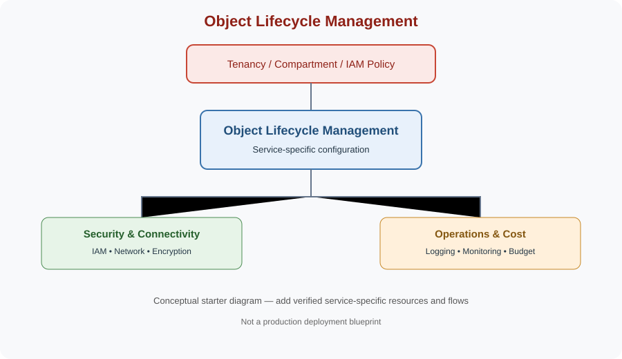

# Object Lifecycle Management

> **Category:** [Storage & Enterprise File Services](../README.md) · [Category SVG](../architecture.svg) · [Category editable draw.io](../architecture.drawio)



## 1. Purpose and fit
Use [official OCI documentation](https://docs.oracle.com/en-us/iaas/Content/home.htm) to confirm current capabilities, supported regions, service limits, pricing and operational model for Object Lifecycle Management. Begin with workload requirements and selection criteria.

## 2. Architecture placement
Map the service to its tenancy and compartment boundary, IAM policy scope, calling workload, dependent services, VCN/network flows where applicable, data classification and operational ownership.

## 3. Design checklist
- [ ] Define business purpose, non-functional requirements and SLOs.
- [ ] Identify region and availability-domain/fault-domain assumptions where applicable.
- [ ] Define compartment ownership, tags, quotas and lifecycle.
- [ ] Document IAM policies, groups/dynamic groups and workload principals.
- [ ] Document ingress/egress, routes, gateways, DNS and connectivity where relevant.
- [ ] Define encryption, key/secret handling, data retention and recovery.
- [ ] Plan monitoring, logging, audit evidence, alarms and runbooks.
- [ ] Estimate cost drivers and assign budget ownership.
- [ ] Define backup/restore, capacity and failure tests as relevant.

## 4. Identity and security
Use least privilege and explicit compartment scoping in OCI IAM policies. Prefer supported instance principals or resource principals for workload-to-service access when suitable. Use OCI Vault for keys and secrets where appropriate. Validate policy syntax, permissions and restrictions in Oracle docs.

## 5. Networking and connectivity
Document VCN/subnet/route/security controls, gateway and private connectivity needs, endpoint exposure, DNS, egress and on-premises connectivity where applicable. Do not assume every OCI service has the same network attachment model.

## 6. Reliability and operations
Define supported availability design, quotas, scaling, backup/restore and monitoring. Use OCI Monitoring/Alarms and Logging where appropriate. Test failure and recovery behavior; confirm service-specific capabilities before relying on multi-AD or cross-region designs.

## 7. Infrastructure as Code
Use Terraform with the Oracle OCI provider or OCI Resource Manager where appropriate. Protect state, pin provider versions, review plans, avoid committing credentials and validate arguments against the provider version in use.

Generic provider scaffold (not a complete deployment):

```hcl
terraform {
  required_providers {
    oci = {
      source = "oracle/oci"
    }
  }
}
provider "oci" {
  region = var.region
}
variable "region" {
  type        = string
  description = "OCI region identifier"
}
```

## 8. Hands-on lab
1. Read the official service overview and quickstart.
2. Create a minimal lab in a sandbox compartment.
3. Validate behavior, IAM authorization, connectivity and observability.
4. Test a denied-access or failure scenario.
5. Review charges, delete lab resources and confirm cleanup.

## 9. Alternatives and trade-offs
Compare alternatives by fit, availability, latency, consistency, performance, compliance, operational burden and total cost. Document assumptions rather than treating the service as a default.

## 10. Interview questions
1. What problem does Object Lifecycle Management solve?
2. What OCI IAM policy or workload identity choices matter?
3. What network, region or compartment assumptions matter?
4. What availability, quota and failure risks need planning?
5. How would you monitor, troubleshoot and optimize cost?
6. What alternatives would you compare?

## Official references
- [OCI documentation](https://docs.oracle.com/en-us/iaas/Content/home.htm)
- [OCI Architecture Center](https://www.oracle.com/cloud/architecture/)
- [OCI Well-Architected Framework](https://docs.oracle.com/en/solutions/oci-well-architected-framework/)
- [OCI Terraform provider](https://registry.terraform.io/providers/oracle/oci/latest/docs)
- [OCI pricing](https://www.oracle.com/cloud/pricing/)

> **Validation status:** Structured learning scaffold. Verify service-specific options, IAM permissions, Terraform resources, regional availability, limits and prices against current Oracle documentation before production use.
