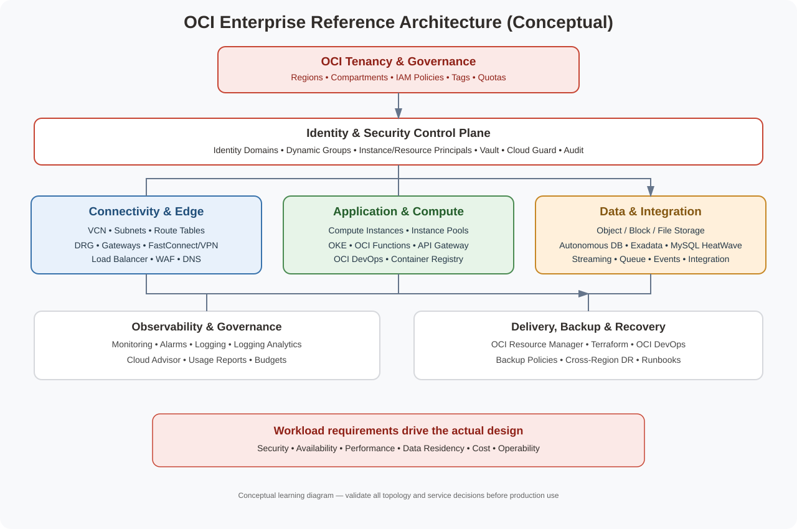

# OCI Master Vault ☁️
> **Oracle Cloud Infrastructure architecture learning portal** — track your learning, explore the end-to-end enterprise reference design, and open focused guides for OCI services.

## Start here

| 📚 Learning tracker | 🏗️ End-to-end design | 🗺️ Diagram library |
|---|---|---|
| Work through the catalogue by category. Every topic opens its own guide. | Explore tenancy, compartments, IAM, networking, workloads, data, security and operations. | Preview SVGs and open editable draw.io sources. |
| [Track topics below ↓](#your-oci-learning-tracker) | [Open reference design](OCI-ENTERPRISE-REFERENCE-ARCHITECTURE.md) | [Open visual library](VISUAL-DIAGRAMS.md) |

## Catalogue overview

**Catalogue size:** 115 OCI component and architecture-topic guides across 13 categories.

| Domain | Category | Topics | Tracker |
|---|---|---:|---|
| **A** | [Cloud Foundation & Landing Zones](A-cloud-foundation-landing-zones/README.md) | 9 | [Open tracker](#a-cloud-foundation-landing-zones) |
| **B** | [Identity & Access Management](B-identity-access-management/README.md) | 8 | [Open tracker](#b-identity-access-management) |
| **C** | [Networking & Private Connectivity](C-networking-private-connectivity/README.md) | 12 | [Open tracker](#c-networking-private-connectivity) |
| **D** | [Traffic Management & Delivery](D-traffic-management-delivery/README.md) | 8 | [Open tracker](#d-traffic-management-delivery) |
| **E** | [Compute & Application Hosting](E-compute-application-hosting/README.md) | 9 | [Open tracker](#e-compute-application-hosting) |
| **F** | [Containers & Kubernetes](F-containers-kubernetes/README.md) | 7 | [Open tracker](#f-containers-kubernetes) |
| **G** | [Storage & Enterprise File Services](G-storage-enterprise-file-services/README.md) | 8 | [Open tracker](#g-storage-enterprise-file-services) |
| **H** | [Databases & Data Platforms](H-databases-data-platforms/README.md) | 10 | [Open tracker](#h-databases-data-platforms) |
| **I** | [Integration & API Management](I-integration-api-management/README.md) | 8 | [Open tracker](#i-integration-api-management) |
| **J** | [Security, Secrets & Governance](J-security-secrets-governance/README.md) | 8 | [Open tracker](#j-security-secrets-governance) |
| **K** | [Monitoring, Operations & Cost](K-monitoring-operations-cost/README.md) | 10 | [Open tracker](#k-monitoring-operations-cost) |
| **L** | [DevOps, Resilience, Migration & AI](L-devops-resilience-migration-ai/README.md) | 10 | [Open tracker](#l-devops-resilience-migration-ai) |
| **12** | [Automation, Backup & Disaster Recovery](12-automation-backup-disaster-recovery/README.md) | 8 | [Open tracker](#12-automation-backup-disaster-recovery) |

## Your OCI learning tracker

Use checkboxes as a visible checklist and select a topic to open its detailed guide. GitHub Markdown checkboxes are manual; they do not calculate a live completion percentage.

### Component checklist

<strong>A. Cloud Foundation & Landing Zones</strong> — 9 topics

- [ ] [Oracle Cloud Infrastructure Fundamentals](A-cloud-foundation-landing-zones/oracle-cloud-infrastructure-fundamentals/README.md)
- [ ] [Tenancies, Regions & Availability Domains](A-cloud-foundation-landing-zones/tenancies-regions-availability-domains/README.md)
- [ ] [Compartments & Resource Hierarchy](A-cloud-foundation-landing-zones/compartments-resource-hierarchy/README.md)
- [ ] [Tags, Tag Defaults & Cost Tracking](A-cloud-foundation-landing-zones/tags-tag-defaults-cost-tracking/README.md)
- [ ] [Quotas, Limits & Service Limits](A-cloud-foundation-landing-zones/quotas-limits-service-limits/README.md)
- [ ] [OCI Core Landing Zone](A-cloud-foundation-landing-zones/oci-core-landing-zone/README.md)
- [ ] [OCI Well-Architected Framework](A-cloud-foundation-landing-zones/oci-well-architected-framework/README.md)
- [ ] [Cloud Advisor](A-cloud-foundation-landing-zones/cloud-advisor/README.md)
- [ ] [Support Requests & Service Limits](A-cloud-foundation-landing-zones/support-requests-service-limits/README.md)

[Open category tracker](A-cloud-foundation-landing-zones/README.md) · [SVG](A-cloud-foundation-landing-zones/architecture.svg) · [editable draw.io](A-cloud-foundation-landing-zones/architecture.drawio)

<strong>B. Identity & Access Management</strong> — 8 topics

- [ ] [OCI IAM Overview](B-identity-access-management/oci-iam-overview/README.md)
- [ ] [Identity Domains](B-identity-access-management/identity-domains/README.md)
- [ ] [Users, Groups & Dynamic Groups](B-identity-access-management/users-groups-dynamic-groups/README.md)
- [ ] [IAM Policies](B-identity-access-management/iam-policies/README.md)
- [ ] [Federation & Identity Providers](B-identity-access-management/federation-identity-providers/README.md)
- [ ] [Instance Principals](B-identity-access-management/instance-principals/README.md)
- [ ] [Resource Principals](B-identity-access-management/resource-principals/README.md)
- [ ] [Workload Identity & Secrets Access](B-identity-access-management/workload-identity-secrets-access/README.md)

[Open category tracker](B-identity-access-management/README.md) · [SVG](B-identity-access-management/architecture.svg) · [editable draw.io](B-identity-access-management/architecture.drawio)

<strong>C. Networking & Private Connectivity</strong> — 12 topics

- [ ] [Virtual Cloud Networks (VCNs)](C-networking-private-connectivity/virtual-cloud-networks-vcns/README.md)
- [ ] [Subnets & CIDR Planning](C-networking-private-connectivity/subnets-cidr-planning/README.md)
- [ ] [Route Tables](C-networking-private-connectivity/route-tables/README.md)
- [ ] [Security Lists](C-networking-private-connectivity/security-lists/README.md)
- [ ] [Network Security Groups (NSGs)](C-networking-private-connectivity/network-security-groups-nsgs/README.md)
- [ ] [Dynamic Routing Gateway (DRG)](C-networking-private-connectivity/dynamic-routing-gateway-drg/README.md)
- [ ] [Local Peering Gateway (LPG)](C-networking-private-connectivity/local-peering-gateway-lpg/README.md)
- [ ] [Internet Gateway](C-networking-private-connectivity/internet-gateway/README.md)
- [ ] [NAT Gateway](C-networking-private-connectivity/nat-gateway/README.md)
- [ ] [Service Gateway](C-networking-private-connectivity/service-gateway/README.md)
- [ ] [FastConnect](C-networking-private-connectivity/fastconnect/README.md)
- [ ] [Site-to-Site VPN](C-networking-private-connectivity/site-to-site-vpn/README.md)

[Open category tracker](C-networking-private-connectivity/README.md) · [SVG](C-networking-private-connectivity/architecture.svg) · [editable draw.io](C-networking-private-connectivity/architecture.drawio)

<strong>D. Traffic Management & Delivery</strong> — 8 topics

- [ ] [OCI Load Balancer](D-traffic-management-delivery/oci-load-balancer/README.md)
- [ ] [Network Load Balancer](D-traffic-management-delivery/network-load-balancer/README.md)
- [ ] [DNS Zones & Records](D-traffic-management-delivery/dns-zones-records/README.md)
- [ ] [Traffic Management Steering Policies](D-traffic-management-delivery/traffic-management-steering-policies/README.md)
- [ ] [Web Application Firewall (WAF)](D-traffic-management-delivery/web-application-firewall-waf/README.md)
- [ ] [Certificates & TLS](D-traffic-management-delivery/certificates-tls/README.md)
- [ ] [Health Checks & Backend Sets](D-traffic-management-delivery/health-checks-backend-sets/README.md)
- [ ] [OCI API Gateway](D-traffic-management-delivery/oci-api-gateway/README.md)

[Open category tracker](D-traffic-management-delivery/README.md) · [SVG](D-traffic-management-delivery/architecture.svg) · [editable draw.io](D-traffic-management-delivery/architecture.drawio)

<strong>E. Compute & Application Hosting</strong> — 9 topics

- [ ] [Compute Instances](E-compute-application-hosting/compute-instances/README.md)
- [ ] [Compute Shapes](E-compute-application-hosting/compute-shapes/README.md)
- [ ] [Custom Images & Image Management](E-compute-application-hosting/custom-images-image-management/README.md)
- [ ] [Instance Configurations](E-compute-application-hosting/instance-configurations/README.md)
- [ ] [Instance Pools](E-compute-application-hosting/instance-pools/README.md)
- [ ] [Autoscaling](E-compute-application-hosting/autoscaling/README.md)
- [ ] [OCI Functions](E-compute-application-hosting/oci-functions/README.md)
- [ ] [API Gateway](E-compute-application-hosting/api-gateway/README.md)
- [ ] [Bastion Service](E-compute-application-hosting/bastion-service/README.md)

[Open category tracker](E-compute-application-hosting/README.md) · [SVG](E-compute-application-hosting/architecture.svg) · [editable draw.io](E-compute-application-hosting/architecture.drawio)

<strong>F. Containers & Kubernetes</strong> — 7 topics

- [ ] [Oracle Cloud Infrastructure Container Engine for Kubernetes (OKE)](F-containers-kubernetes/oci-container-engine-for-kubernetes-oke/README.md)
- [ ] [OKE Cluster Design](F-containers-kubernetes/oke-cluster-design/README.md)
- [ ] [OKE Node Pools](F-containers-kubernetes/oke-node-pools/README.md)
- [ ] [Oracle Cloud Infrastructure Registry (OCIR)](F-containers-kubernetes/oracle-cloud-infrastructure-registry-ocir/README.md)
- [ ] [Container Instances](F-containers-kubernetes/container-instances/README.md)
- [ ] [Kubernetes Networking & Ingress](F-containers-kubernetes/kubernetes-networking-ingress/README.md)
- [ ] [OKE Autoscaling](F-containers-kubernetes/oke-autoscaling/README.md)

[Open category tracker](F-containers-kubernetes/README.md) · [SVG](F-containers-kubernetes/architecture.svg) · [editable draw.io](F-containers-kubernetes/architecture.drawio)

<strong>G. Storage & Enterprise File Services</strong> — 8 topics

- [ ] [Object Storage](G-storage-enterprise-file-services/object-storage/README.md)
- [ ] [Block Volume](G-storage-enterprise-file-services/block-volume/README.md)
- [ ] [Boot Volumes](G-storage-enterprise-file-services/boot-volumes/README.md)
- [ ] [Volume Groups & Replication](G-storage-enterprise-file-services/volume-groups-replication/README.md)
- [ ] [File Storage Service (FSS)](G-storage-enterprise-file-services/file-storage-service-fss/README.md)
- [ ] [Archive Storage](G-storage-enterprise-file-services/archive-storage/README.md)
- [ ] [Object Lifecycle Management](G-storage-enterprise-file-services/object-lifecycle-management/README.md)
- [ ] [Storage Backups & Recovery](G-storage-enterprise-file-services/storage-backups-recovery/README.md)

[Open category tracker](G-storage-enterprise-file-services/README.md) · [SVG](G-storage-enterprise-file-services/architecture.svg) · [editable draw.io](G-storage-enterprise-file-services/architecture.drawio)

<strong>H. Databases & Data Platforms</strong> — 10 topics

- [ ] [Autonomous Database](H-databases-data-platforms/autonomous-database/README.md)
- [ ] [Base Database Service](H-databases-data-platforms/base-database-service/README.md)
- [ ] [Exadata Database Service](H-databases-data-platforms/exadata-database-service/README.md)
- [ ] [MySQL HeatWave](H-databases-data-platforms/mysql-heatwave/README.md)
- [ ] [Oracle NoSQL Database Cloud Service](H-databases-data-platforms/oracle-nosql-database-cloud-service/README.md)
- [ ] [Database Tools](H-databases-data-platforms/database-tools/README.md)
- [ ] [Database Management](H-databases-data-platforms/database-management/README.md)
- [ ] [Oracle Analytics Cloud](H-databases-data-platforms/oracle-analytics-cloud/README.md)
- [ ] [GoldenGate](H-databases-data-platforms/goldengate/README.md)
- [ ] [Database Migration Service](H-databases-data-platforms/database-migration-service/README.md)

[Open category tracker](H-databases-data-platforms/README.md) · [SVG](H-databases-data-platforms/architecture.svg) · [editable draw.io](H-databases-data-platforms/architecture.drawio)

<strong>I. Integration & API Management</strong> — 8 topics

- [ ] [OCI Integration](I-integration-api-management/oci-integration/README.md)
- [ ] [API Gateway](I-integration-api-management/api-gateway/README.md)
- [ ] [Streaming](I-integration-api-management/streaming/README.md)
- [ ] [Queue](I-integration-api-management/queue/README.md)
- [ ] [Events Service](I-integration-api-management/events-service/README.md)
- [ ] [Notifications](I-integration-api-management/notifications/README.md)
- [ ] [Service Connector Hub](I-integration-api-management/service-connector-hub/README.md)
- [ ] [Email Delivery](I-integration-api-management/email-delivery/README.md)

[Open category tracker](I-integration-api-management/README.md) · [SVG](I-integration-api-management/architecture.svg) · [editable draw.io](I-integration-api-management/architecture.drawio)

<strong>J. Security, Secrets & Governance</strong> — 8 topics

- [ ] [OCI Vault](J-security-secrets-governance/oci-vault/README.md)
- [ ] [Cloud Guard](J-security-secrets-governance/cloud-guard/README.md)
- [ ] [Security Zones](J-security-secrets-governance/security-zones/README.md)
- [ ] [Vulnerability Scanning](J-security-secrets-governance/vulnerability-scanning/README.md)
- [ ] [Data Safe](J-security-secrets-governance/data-safe/README.md)
- [ ] [OCI Bastion](J-security-secrets-governance/oci-bastion/README.md)
- [ ] [Certificates](J-security-secrets-governance/certificates/README.md)
- [ ] [Audit Service](J-security-secrets-governance/audit-service/README.md)

[Open category tracker](J-security-secrets-governance/README.md) · [SVG](J-security-secrets-governance/architecture.svg) · [editable draw.io](J-security-secrets-governance/architecture.drawio)

<strong>K. Monitoring, Operations & Cost</strong> — 10 topics

- [ ] [Monitoring Service](K-monitoring-operations-cost/monitoring-service/README.md)
- [ ] [Alarms](K-monitoring-operations-cost/alarms/README.md)
- [ ] [Logging Service](K-monitoring-operations-cost/logging-service/README.md)
- [ ] [Logging Analytics](K-monitoring-operations-cost/logging-analytics/README.md)
- [ ] [Application Performance Monitoring](K-monitoring-operations-cost/application-performance-monitoring/README.md)
- [ ] [Operations Insights](K-monitoring-operations-cost/operations-insights/README.md)
- [ ] [Budgets & Cost Analysis](K-monitoring-operations-cost/budgets-cost-analysis/README.md)
- [ ] [Usage Reports](K-monitoring-operations-cost/usage-reports/README.md)
- [ ] [Resource Search](K-monitoring-operations-cost/resource-search/README.md)
- [ ] [Events and Notifications Operations](K-monitoring-operations-cost/events-and-notifications-operations/README.md)

[Open category tracker](K-monitoring-operations-cost/README.md) · [SVG](K-monitoring-operations-cost/architecture.svg) · [editable draw.io](K-monitoring-operations-cost/architecture.drawio)

<strong>L. DevOps, Resilience, Migration & AI</strong> — 10 topics

- [ ] [OCI Resource Manager](L-devops-resilience-migration-ai/oci-resource-manager/README.md)
- [ ] [Terraform for OCI](L-devops-resilience-migration-ai/terraform-for-oci/README.md)
- [ ] [OCI DevOps](L-devops-resilience-migration-ai/oci-devops/README.md)
- [ ] [Full Stack Disaster Recovery](L-devops-resilience-migration-ai/full-stack-disaster-recovery/README.md)
- [ ] [Cloud Migrations](L-devops-resilience-migration-ai/cloud-migrations/README.md)
- [ ] [Generative AI Service](L-devops-resilience-migration-ai/generative-ai-service/README.md)
- [ ] [OCI AI Services](L-devops-resilience-migration-ai/oci-ai-services/README.md)
- [ ] [Data Science](L-devops-resilience-migration-ai/data-science/README.md)
- [ ] [Vision](L-devops-resilience-migration-ai/vision/README.md)
- [ ] [Document Understanding](L-devops-resilience-migration-ai/document-understanding/README.md)

[Open category tracker](L-devops-resilience-migration-ai/README.md) · [SVG](L-devops-resilience-migration-ai/architecture.svg) · [editable draw.io](L-devops-resilience-migration-ai/architecture.drawio)

<strong>12. Automation, Backup & Disaster Recovery</strong> — 8 topics

- [ ] [OCI CLI](12-automation-backup-disaster-recovery/oci-cli/README.md)
- [ ] [OCI SDKs](12-automation-backup-disaster-recovery/oci-sdks/README.md)
- [ ] [Automation with Functions](12-automation-backup-disaster-recovery/automation-with-functions/README.md)
- [ ] [Block Volume Backups](12-automation-backup-disaster-recovery/block-volume-backups/README.md)
- [ ] [Database Backups](12-automation-backup-disaster-recovery/database-backups/README.md)
- [ ] [Cross-Region Replication](12-automation-backup-disaster-recovery/cross-region-replication/README.md)
- [ ] [Recovery Runbooks](12-automation-backup-disaster-recovery/recovery-runbooks/README.md)
- [ ] [Disaster Recovery Testing](12-automation-backup-disaster-recovery/disaster-recovery-testing/README.md)

[Open category tracker](12-automation-backup-disaster-recovery/README.md) · [SVG](12-automation-backup-disaster-recovery/architecture.svg) · [editable draw.io](12-automation-backup-disaster-recovery/architecture.drawio)

## Portfolio projects
- [ ] OCI three-tier application with OCI Load Balancer, Compute, private subnets and database.
- [ ] Hub-and-spoke VCN design with DRG, route controls and private connectivity.
- [ ] OKE container platform using OCIR, workload identity and observability.
- [ ] Autonomous Database application with controlled access, secrets and recovery.
- [ ] Governed OCI landing zone using compartments, IAM policies, tags, quotas and audit.
- [ ] Multi-region recovery design with runbooks and RTO/RPO testing.
- [ ] Event-driven application using Events, Functions, Streaming/Queue and Object Storage.
- [ ] OCI Generative AI application with access controls, evaluation and cost monitoring.

## Lab evidence standard
Record objective, architecture, prerequisites, policies, commands/IaC, validation, failure test, costs, cleanup evidence and limitations.

## Safety reminders
- Use a dedicated sandbox compartment and monitor actual usage.
- Never commit OCI API private keys, auth tokens, certificates, passwords or production data.
- Grant least privilege and validate IAM policy compartment scope.
- Confirm region availability and quotas before provisioning.
- Plan teardown before creating billable resources.

## Official starting points
- [OCI documentation](https://docs.oracle.com/en-us/iaas/Content/home.htm)
- [OCI Architecture Center](https://www.oracle.com/cloud/architecture/)
- [OCI Well-Architected Framework](https://docs.oracle.com/en/solutions/oci-well-architected-framework/)
- [OCI Core Landing Zone](https://github.com/oci-landing-zones/oci-core-landingzone)
- [OCI Terraform provider](https://registry.terraform.io/providers/oracle/oci/latest/docs)
- [OCI pricing](https://www.oracle.com/cloud/pricing/)

> **Validation status:** OCI-specific learning scaffold. Diagrams and standard guides are not individually production-certified; validate service-specific IAM, region support, limits, Terraform arguments and pricing before real deployment.
