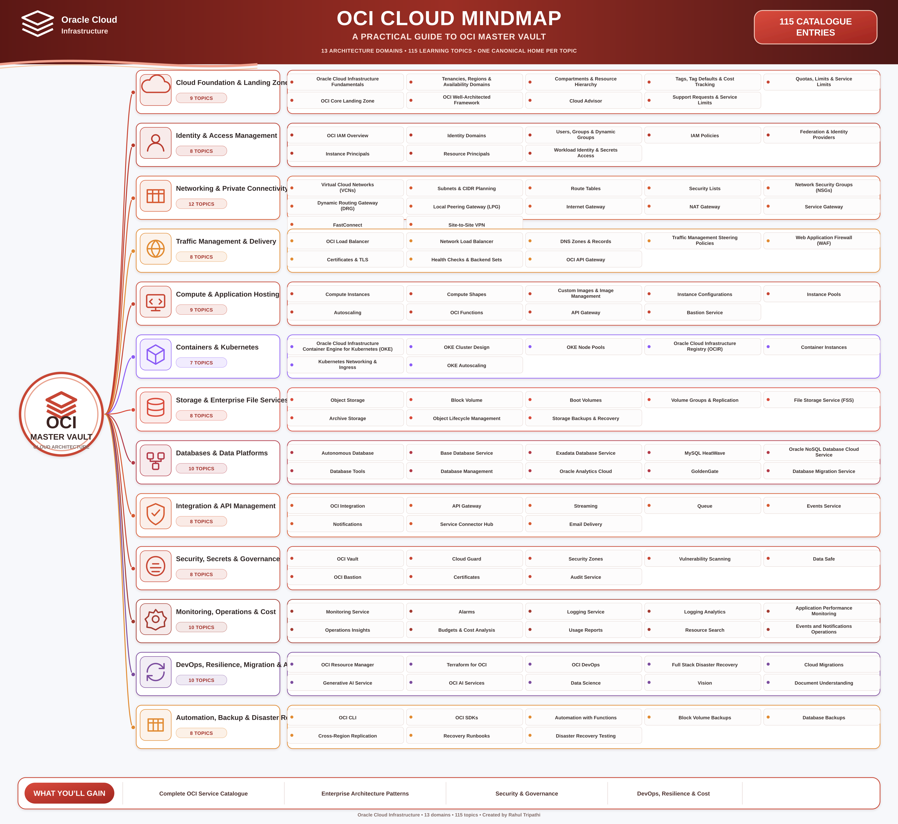
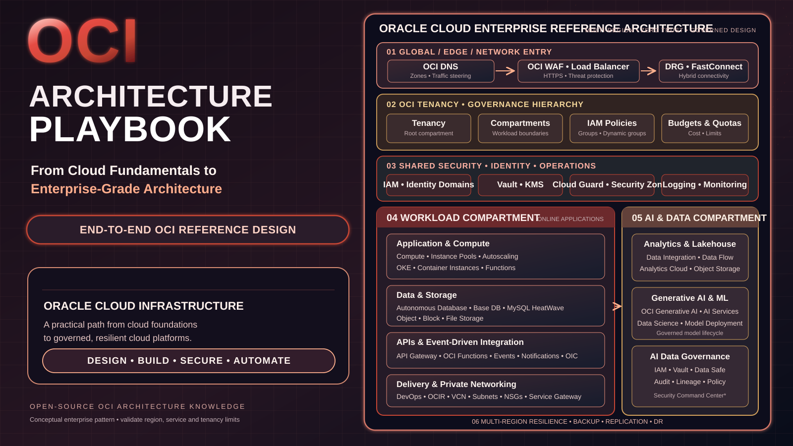
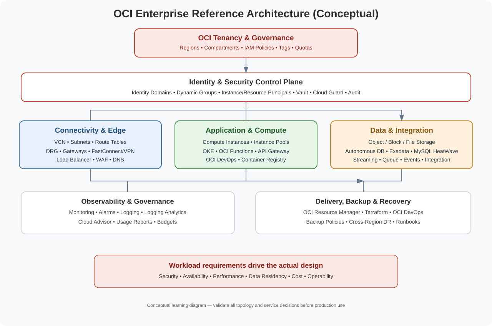

# OCI Master Vault ☁️
> **Oracle Cloud Infrastructure architecture learning portal** — track your learning, explore the end-to-end enterprise reference design, and open focused guides for OCI services.

## OCI component catalogue mind map

The OCI Master Vault mind map follows the same visual structure as the AWS and GCP vaults: a central cloud hub, named architecture-domain panels, connected topic tiles, and a consistent reference footer. It covers **13 architecture domains and 115 learning topics**.

  

- [Open the 4K PNG mind map](OCI-COMPONENT-MINDMAP.png)
- [Open the scalable SVG mind map](OCI-COMPONENT-MINDMAP.svg)
- [Edit the mind map in diagrams.net](OCI-COMPONENT-MINDMAP.drawio)

## Start here

| 📚 Learning tracker | 🏗️ End-to-end design | 🗺️ Diagram library |
|---|---|---|
| Work through the catalogue by category. Every topic opens its own guide. | Explore tenancy, compartments, IAM, networking, workloads, data, security and operations. | Preview SVGs and open editable draw.io sources. |
| [Track topics below ↓](#your-oci-learning-tracker) | [Open reference design](OCI-ENTERPRISE-REFERENCE-ARCHITECTURE.md) | [Open visual library](VISUAL-DIAGRAMS.md) |

## Catalogue overview

**Catalogue size:** 115 OCI component and architecture-topic guides across 13 categories.

| Domain | Category | Topics | Tracker |
|---|---|---:|---|
| **A** | [Cloud Foundation & Landing Zones](A-cloud-foundation-landing-zones/README.md) | 9 | [Open tracker](#a-cloud-foundation-landing-zones) |
| **B** | [Identity & Access Management](B-identity-access-management/README.md) | 8 | [Open tracker](#b-identity-access-management) |
| **C** | [Networking & Private Connectivity](C-networking-private-connectivity/README.md) | 12 | [Open tracker](#c-networking-private-connectivity) |
| **D** | [Traffic Management & Delivery](D-traffic-management-delivery/README.md) | 8 | [Open tracker](#d-traffic-management-delivery) |
| **E** | [Compute & Application Hosting](E-compute-application-hosting/README.md) | 9 | [Open tracker](#e-compute-application-hosting) |
| **F** | [Containers & Kubernetes](F-containers-kubernetes/README.md) | 7 | [Open tracker](#f-containers-kubernetes) |
| **G** | [Storage & Enterprise File Services](G-storage-enterprise-file-services/README.md) | 8 | [Open tracker](#g-storage-enterprise-file-services) |
| **H** | [Databases & Data Platforms](H-databases-data-platforms/README.md) | 10 | [Open tracker](#h-databases-data-platforms) |
| **I** | [Integration & API Management](I-integration-api-management/README.md) | 8 | [Open tracker](#i-integration-api-management) |
| **J** | [Security, Secrets & Governance](J-security-secrets-governance/README.md) | 8 | [Open tracker](#j-security-secrets-governance) |
| **K** | [Monitoring, Operations & Cost](K-monitoring-operations-cost/README.md) | 10 | [Open tracker](#k-monitoring-operations-cost) |
| **L** | [DevOps, Resilience, Migration & AI](L-devops-resilience-migration-ai/README.md) | 10 | [Open tracker](#l-devops-resilience-migration-ai) |
| **12** | [Automation, Backup & Disaster Recovery](12-automation-backup-disaster-recovery/README.md) | 8 | [Open tracker](#12-automation-backup-disaster-recovery) |

## Your OCI learning tracker

The interactive learning catalogue brings the progress board and all 115 topic checkboxes together on one page. Check a topic to update the overall progress bar and its domain milestone immediately.

Progress is saved in the current browser on this device. Export a JSON backup to transfer progress to another browser or device. The expandable catalogue lists below remain the static reference and preserve every detailed guide link.

### Component checklist

## Portfolio projects
- [ ] OCI three-tier application with OCI Load Balancer, Compute, private subnets and database.
- [ ] Hub-and-spoke VCN design with DRG, route controls and private connectivity.
- [ ] OKE container platform using OCIR, workload identity and observability.
- [ ] Autonomous Database application with controlled access, secrets and recovery.
- [ ] Governed OCI landing zone using compartments, IAM policies, tags, quotas and audit.
- [ ] Multi-region recovery design with runbooks and RTO/RPO testing.
- [ ] Event-driven application using Events, Functions, Streaming/Queue and Object Storage.
- [ ] OCI Generative AI application with access controls, evaluation and cost monitoring.

## Lab evidence standard
Record objective, architecture, prerequisites, policies, commands/IaC, validation, failure test, costs, cleanup evidence and limitations.

## Safety reminders
- Use a dedicated sandbox compartment and monitor actual usage.
- Never commit OCI API private keys, auth tokens, certificates, passwords or production data.
- Grant least privilege and validate IAM policy compartment scope.
- Confirm region availability and quotas before provisioning.
- Plan teardown before creating billable resources.

## Official starting points
- [OCI documentation](https://docs.oracle.com/en-us/iaas/Content/home.htm)
- [OCI Architecture Center](https://www.oracle.com/cloud/architecture/)
- [OCI Well-Architected Framework](https://docs.oracle.com/en/solutions/oci-well-architected-framework/)
- [OCI Core Landing Zone](https://github.com/oci-landing-zones/oci-core-landingzone)
- [OCI Terraform provider](https://registry.terraform.io/providers/oracle/oci/latest/docs)
- [OCI pricing](https://www.oracle.com/cloud/pricing/)

> **Validation status:** OCI-specific learning scaffold. Diagrams and standard guides are not individually production-certified; validate service-specific IAM, region support, limits, Terraform arguments and pricing before real deployment.

## Licensing and attribution

- **Original code and software:** MIT License — see [LICENSE](LICENSE).
- **Original documentation, learning notes, and architecture diagrams:** CC BY 4.0 — see [LICENSE-DOCS.md](LICENSE-DOCS.md).
- **Third-party material:** Cloud-provider names, trademarks, product screenshots, excerpts, icons, images, fonts, and other third-party content are not relicensed by this repository. Follow the original owner's terms and the attribution/source notices in the relevant files.

These licenses apply only to original material that the repository owner has the right to license. If a file contains a more specific license or attribution notice, follow that notice.

---

## Licensing and permitted use

This repository is provided for personal learning, portfolio review, and other **noncommercial use only**. Commercial or business use requires prior written permission.

- **Documentation, learning notes and original diagrams:** [CC BY-NC 4.0](LICENSE-DOCS.md).
- **Code, scripts, automation and infrastructure-as-code:** [PolyForm Noncommercial 1.0.0](LICENSE-CODE.md).
- **Commercial use:** Not permitted without a separate written commercial licence. This includes business use, paid training or consulting, commercial hosting, resale, and incorporation into a commercial product or service.
- **Third-party material:** Provider names, trademarks, vendor documentation, screenshots, excerpts, icons, images, fonts and dependencies are not relicensed here. Their owners' terms apply.

These terms apply only to original material the repository owner has the right to license. This is source-available, not OSI-approved open-source software.

**Legacy licence notice:** Earlier repository versions may have carried MIT and/or CC BY grants. This update does not retroactively revoke permissions already granted under those earlier versions. See [LICENSE](LICENSE) for the transition notice.
